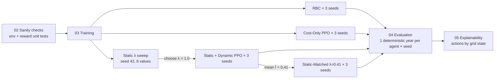

# 02 · Methodology

Previous: [[01 - Problem and Background]] · Next: [[03 - Results and Discussion]]

> [!abstract] In short
> Five controllers manage the batteries of 5 simulated buildings for one year each. Four are PPO agents that are **identical except for their reward function**; the fifth is a rule-based controller. Each is run on 3 random seeds and compared on cost, CO₂, self-consumption, training stability and behaviour.

---

## 1. Simulation environment: CityLearn

| Item | Value |
|---|---|
| Simulator | **CityLearn 2.1.2**, an open-source building energy RL benchmark |
| Dataset | `citylearn_challenge_2022_phase_1` |
| Buildings | **5** residential buildings, each with **rooftop PV** and a **battery (BESS)** |
| Time step | 1 hour |
| Episode | **8,760 steps = one full year** |
| Signals used | electricity price (time-of-use tariff), grid **carbon intensity** (kg CO₂/kWh, range ≈ 0.070–0.282), solar generation, building load, battery state of charge |

**Control setup:** a single **central agent** controls all 5 batteries.

- **Observation:** a 60-dimensional vector (time features, weather, load, solar, state of charge, price, carbon intensity, …).
- **Action:** 5 continuous values in [−0.78, 0.78], one battery charge rate per building. **Positive = charge**, **negative = discharge**.

**Cost and carbon per hour** are read from CityLearn's own building accounting, summed over the 5 buildings:

- cost = price × net grid consumption. Exports earn money, so cost can be negative.
- carbon = carbon intensity × net grid consumption, clipped at 0. Exporting earns no carbon credit.

---

## 2. The controllers

| # | Controller | Reward | Why it is included |
|---|---|---|---|
| 1 | **Rule-Based Controller (RBC)** | none (CityLearn `BasicRBC`, fixed time-of-day rules) | The industry-style baseline and the reference for "CO₂ avoided" |
| 2 | **Cost-Only PPO** | $R_t = -\text{cost}_t$ | What most RL papers do: optimise the bill and hope carbon follows |
| 3 | **Static carbon-aware PPO** | $R_t = -\text{cost}_t - \lambda\,\text{carbon}_t$, λ = 1.0 | The existing way of adding carbon: a fixed weight |
| 4 | **Dynamic carbon-adaptive PPO** (proposed) | $R_t = -\text{cost}_t - \lambda_0\,\hat I_t\,\text{carbon}_t$, λ₀ = 1.0 | Our method: carbon weight follows grid carbon intensity |
| 5 | **Static-Matched PPO** (added later) | $R_t = -\text{cost}_t - 0.41\,\text{carbon}_t$ | Fair baseline: same *average* carbon weight as Dynamic |

Static and Dynamic share the same base weight (λ = λ₀ = 1.0), but that doesn't make them equally strong. Over the year $\hat I_t$ averages **0.41**, so Dynamic's effective weight is on average 2.5× smaller than Static's. **Static-Matched** (λ = 0.41) fixes this: it has the same average carbon pressure as Dynamic, so comparing the two isolates the effect of the weight *varying with carbon intensity*. See [[03 - Results and Discussion#5. What this means for the paper]].

### Normalising carbon intensity
$I_{\min}$ and $I_{\max}$ are the minimum and maximum of the dataset's carbon intensity series, precomputed once when the environment is built. $\hat I_t$ is clipped to [0, 1] so it stays bounded if test data falls outside the training range.

---

## 3. Learning algorithm: PPO

**Why PPO:** it is the most common on-policy algorithm in CityLearn and building-control papers. It handles continuous actions and is stable with default hyper-parameters, so differences in results can be attributed to the reward rather than to algorithm tuning.

| Hyper-parameter | Value |
|---|---|
| Library | Stable-Baselines3 2.9 (`MlpPolicy`) |
| Network | separate actor / critic MLPs, 2 × 64 hidden units each |
| Learning rate | 3e-4 |
| Rollout length (`n_steps`) | 2048 |
| Batch size | 128 |
| Epochs per update | 10 |
| γ / GAE λ | 0.99 / 0.95 |
| Clip range | 0.2 |
| Entropy coefficient | 0.0 |
| **Training budget** | **50,000 steps per agent ≈ 5.7 simulated years** |
| Seeds | **42, 100, 2026** |

All four PPO agents use **exactly** these settings.

---

## 4. Experimental protocol

1. **Sanity checks:** verify the observation indices, the timing of cost and emission readings, and the sign of solar generation. Unit-test all three reward formulas on a mock environment with hand-computed answers.
2. **λ sweep (static reward, seed 42):** λ ∈ {0.2, 0.4, 0.6, 0.8, 1.0, 5.0}. The sweep has two purposes:
   - *Choose* λ for the main comparison. λ = 1.0 was the original "well-tuned" choice.
   - *Show* how sensitive the static formulation is to this hand-picked number.
3. **Main training:** Cost-Only, Static (λ = 1), Dynamic (λ₀ = 1) and Static-Matched (λ = 0.41) PPO, each on 3 seeds. That is 12 agents, plus 6 sweep agents.
4. **Evaluation:** load each saved checkpoint and run **one full year deterministically** (no exploration noise). The RBC is run the same way.

---

## 5. Metrics

### RL metrics
- **Training curves:** total episode reward against training steps, mean ± std over seeds. The same curves are also shown in cost and carbon units, because reward scales differ between methods.
- **Stability:** standard deviation across seeds.

### Climate / energy metrics
- **Annual operational cost ($)** and **annual emissions (kg CO₂-eq)**, mean ± std over 3 seeds.
- **CO₂ avoided vs RBC** = RBC emissions − method emissions.
- **Renewable self-consumption** = share of PV generation used on-site rather than exported.
- **Pareto frontier:** a cost (y) vs carbon (x) scatter. Better methods sit lower and further left.

### Explainability (post-hoc)
Each hour of the evaluation year is labelled by **carbon-intensity percentile** and **price percentile**. "High" means ≥ 80th percentile and "low" means ≤ 20th. For each grid state we compare the **average battery action** of each agent. The most informative states are the conflict states:
- **High carbon & low price:** cheap but dirty. A cost-only agent wants to charge here; a carbon-aware one should not.
- **Low carbon & high price:** clean but expensive.

We also plot the mean action against carbon-intensity decile. A carbon-aware agent should charge less as the grid gets dirtier.

---

## 6. What was done in the code

### Code organisation
The original scripts (removed in the October 2026 reorganisation; see git history) were reorganised into numbered Jupyter notebooks in `01_notebook_pipeline/notebooks/`, so code and outputs sit together:

| Notebook | Contents | Replaces |
|---|---|---|
| `01_setup_and_core` | config, reward functions, environment wrapper, callback, shared train / evaluate helpers (definitions only) | `config.py`, `rewards.py`, `env_utils.py` + duplicated code |
| `02_sanity_checks` | environment verification + 5 reward unit tests | `verify_env.py`, `test_rewards.py` |
| `03_training` | RBC, Cost-Only, λ sweep, Static, Dynamic and Static-Matched agents | `train_baselines.py`, `train_static_sweep.py`, `train_carbon_agents.py`, `run_all_training.py` |
| `04_evaluation_and_plots` | re-evaluation of all checkpoints, summary table, Pareto plot, training curves | `evaluate.py` |
| `05_policy_explainability` | action analysis by grid state + report | `explain.py` |

Every later notebook loads `01` with `%run`. Shared logic is written once: the training callback had been copied twice and the evaluation loop three times.

### Fixes made while converting

> [!bug] 1. Self-consumption was always 100%
> CityLearn stores `solar_generation` as **negative** numbers. The old evaluation summed them, got a negative total, and fell into an `else: rate = 1.0` branch, so **every** method reported 100%. The old "Finding 3: all agents achieve 100% self-consumption" in `RESULTS.md` came from this bug, not from the data. Fixed by using the absolute value and counting only exports up to that hour's solar generation (battery discharge can also cause export).

> [!bug] 2. Explainability traces were off by one hour
> The traces logged the *next* observation, the one after the action. The price and carbon intensity attached to each action were therefore one hour late. The new traces log the observation the agent actually **acted on**.

> [!bug] 3. Sweep checkpoints saved without `.zip`
> Names such as `ppo_static_lambda_0.2_seed_42` look to SB3 as if they already have an extension (`.2_seed_42`), so it saved them without `.zip`. Paths now add `.zip` explicitly.

> [!bug] 4. Smaller issues
> - The training-curve plot sized its array by the number of configured seeds, not the logs actually found. A missing log would have added zeros to the mean.
> - The explainability report had **263.04 kg** typed in by hand. It is now computed from the evaluation results.
> - The fine λ sweep (0.4 / 0.6 / 0.8) had results on disk but no code that produced them. Both sweeps are now in notebook 03.

### Checks that passed
- All observation indices point at the intended features (carbon intensity = 19, price = 24, …).
- Reading `[-1]` of the cost history right after `step()` gives the cost of the action just taken: per-step sums equal the history sum exactly. **The reward functions are correct.**
- All 5 reward unit tests pass, including that the dynamic reward reduces to cost-only at minimum intensity and to static at maximum intensity.

Continue to [[03 - Results and Discussion]].
